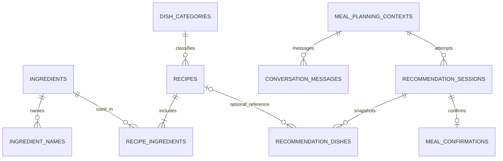

# 03 数据库设计

更新：2026-11-02；本章为完整逻辑设计。M1 已实现目录、菜谱、家庭配置及初始迁移；记忆与推荐记录表将在 M2/M3 实施。单家庭，无user/tenant/member或向量表。

## 1. 原则

FastAPI服务端SQLite为唯一业务真相，Android不运行Python，不复制可写业务库。UUID字符串为ID；时间存UTC，家庭日期按Asia/Shanghai计算。JSON写入前schema校验；布尔和枚举加约束，十进制用量以Decimal处理。总菜数从分类配额派生。

取消market_ingredients和人工availability；当前无图片字段或上传表。App只保存设备设置、最近context/session ID、幂等key和建议的最近已确认清单只读缓存；接入凭证用系统安全存储。

## 2. ER图

profile快照、JSON中分类ID与current_session_id由服务层事务校验，不暗示SQLite自动对JSON内键建立外键。

## 3. 目录与正式菜谱

| 表 | 字段与约束 |
|---|---|
| ingredients | id PK；name必填；ingredient_category可空（蔬菜/肉类/菌菇等食材分类码，不是荤/素/汤）；seasons_json可空；source=default/family；is_hidden；created_at/updated_at/deleted_at |
| ingredient_names | normalized_name PK（主名及别名共用唯一空间）；ingredient_id FK→ingredients RESTRICT；display_name；kind=canonical/alias |
| dish_categories | id PK；name；sort_order；is_active。荤菜/素菜/汤等用于菜单计数，每菜一个主分类 |
| recipes | id PK；name及normalized_name；category_id FK→dish_categories RESTRICT；source仅default/family；可空flavor_tags_json、scene_tags_json、steps、notes、cook_time_minutes、constraint_facts_json；is_hidden；created_at/updated_at/deleted_at |
| recipe_ingredients | recipe_id FK→recipes、ingredient_id FK→ingredients均RESTRICT；联合PK；is_main默认true；quantity/unit成对可空；position |

至少一个主要食材是跨行约束，菜谱与关联必须同事务校验。步骤、用量不强制，已知辅料也用于禁忌检查；清单默认只汇总主要食材。用量若有则>0，烹饪分钟若有则>0。不存图片字段。

seasons_json只允许非空春夏秋冬子集，或仅["all_year"]；null/空数组统一表示未设置，不能把all_year和其他值混用。当季状态运行时派生，不持久化到ingredients。系统名称只读，但单家庭可调整默认食材的季节/隐藏状态；不需要多租户覆盖表。

名称归一采用NFKC、首尾空白及连续空白归一、拉丁字母大小写归一；不盲目删词。每食材恰一个canonical，部分唯一索引及服务事务共同保障。主名与别名冲突返回409并提示复用。删除保留名称映射，重建同名优先恢复旧项。菜名不强制唯一，只提示疑似重复。

可选约束事实记录predicate/value/source/evidence，例如用户明确确认不使用辣椒及含辣调味料。它只支持对应维度，不等于全面安全；做法/食材修改时相关事实须失效或重新核对。模型推测不写入正式事实。

## 4. 家庭设置与轻量记忆

### family_meal_profile

单例id=1；people_count>0；category_counts_json必填，键引用有效菜品类型、值非负整数、和至少1；updated_at。人数建议工程上限30，总菜数20，待实测审核。

家庭时区首版固定Asia/Shanghai；季节月历作为后端产品配置（建议month_based_v1），不增加复杂季节设置平台。分类配额没有第二份total列。

### meal_planning_contexts：本餐短期记忆

| 字段 | 说明 |
|---|---|
| id PK | 一顿饭的规划会话；不是每条消息建一个 |
| status | active / confirmed / closed |
| current_session_id 可空 | 最新可展示结果；引用recommendation_sessions，跨表一致性服务事务校验 |
| effective_config_json | 本餐人数、分类配额，不回写默认 |
| hard_constraints_json / soft_preferences_json | 已校验有效条件；不能依赖自由文本摘要保留硬限制 |
| rejected_dishes_json | 本餐拒绝的正式ID、临时指纹及必要语义范围 |
| resolutions_json | 澄清答案、具体制作核对证据 |
| pending_questions_json | 未解决问题 |
| created_at / updated_at | 并发与恢复 |

目标槽位/本次需保留的槽位放操作请求与session快照中，不永久锁死所有下一轮操作。后续用户可明确选择另一个目标。

### conversation_messages：少量对话上下文

id PK；context_id FK RESTRICT；sequence（context内唯一）；role=user/assistant；content；action_json可空；created_at。

每次模型输入建议最近6条并限总长度；历史消息不必每次全发。结构化状态为有效条件真相，消息用于语气/指代，不做向量检索。模型失败也保留用户消息与已接受条件补丁；重试按操作幂等key避免重复记消息。

### family_preferences：明确长期偏好（轻量设计建议）

id PK；kind=exclude_recipe/exclude_ingredient/soft_preference；target_json；user_statement；created_at/updated_at；is_active。只由用户明确要求长期记住时写入，不从本餐拒绝自动学习。服务端对目标ID、类型和原文证据校验。可通过设置页最小列表删除；高级画像/推荐训练不做。该扩展随整体设计审核。

## 5. 推荐与确认记录

### recommendation_sessions

| 字段 | 说明 |
|---|---|
| id PK；context_id FK | 一次生成/单菜调整尝试 |
| parent_session_id FK可空 | 前一结果，新结果不覆盖旧快照 |
| idempotency_key UNIQUE；input_hash | 防重复，复用key不同输入409 |
| action_json | initial/replace_dish/regenerate及目标/保留槽位 |
| status | generating/needs_clarification/awaiting_confirmation/ready/insufficient/failed/confirmed |
| profile_snapshot_json / effective_constraints_json | 长期输入快照与本次有效条件 |
| time_context_json | as_of_date、timezone、current_season、calendar_id、repeat_window_start/end |
| data_fingerprint | 配方/季节/事实/排除集合摘要，不是菜谱版本机制 |
| shopping_snapshot_json | 名称、食材ID、原用量完整性、来源菜、当时季节状态 |
| warnings_json / failure_json | 结构化告警及失败原因 |
| engine_meta_json | prompt/schema/rule标识、模型、随机种子、候选/淘汰计数、耗时；无密钥 |
| created_at / updated_at / finished_at | 时间戳 |

meal_date/meal_slot可选元数据不改变排除窗口；后端当前日期始终是窗口基准。

### recommendation_dishes

id PK；session_id FK RESTRICT；slot_id及position（session内分别唯一）；recipe_id FK可空；source=default/family/ai_temporary；category_id FK；recipe_snapshot_json；dish_fingerprint；assessment_json；saved_recipe_id FK可空。

所有来源均保存名称、食材ID/名称、已知做法/事实、数量及当时季节快照。临时菜无recipe_id；主动保存关联saved_recipe_id但不改历史source。保留槽位复制相同内容，不要求新结果沿用旧dish行ID；单菜操作明确指向当前session和slot。

### meal_confirmations

id PK；session_id UNIQUE FK；confirmed_at UTC；confirmed_local_date（从confirmed_at转Asia/Shanghai由服务端生成，客户端不能指定）。

查询今天及前两天的confirmed_local_date，联合菜品快照得到排除集合。日期列是查询便利字段，不是第二个可编辑时间来源。没有cooked_at或另点“吃过”的必填操作，也不声称这是真实摄入记录。

确认本餐最新ready结果后，事务写confirmation、session=confirmed、context=confirmed。检查与写入用同一短写事务，避免并发重复。重复confirm返回原记录，不能把自身当新冲突。

## 6. 索引、删除与事务

- recipes(category_id,is_hidden,deleted_at)、recipe_ingredients(ingredient_id)、ingredient_names主键、conversation_messages(context_id,sequence)、recommendation_sessions(context_id,created_at)、recommendation_dishes(session_id)、meal_confirmations(confirmed_local_date)。
- SQLite每连接启用外键。参考：[SQLite外键说明](https://sqlite.org/foreignkeys.html)。逻辑删除仍须应用层引用校验。
- 有有效菜谱引用的食材删除返回409及引用列表；默认目录只隐藏。有效菜谱不得引用已逻辑删除食材；历史独立快照不改。
- 名称/别名修改、菜谱及关联、临时菜主动保存、确认状态分别在短事务完成。临时菜保存以来源dish幂等，创建失败全回滚。
- 对话操作带expected_session_id；提交结果和合并状态时比较当前ID，过期409，不用旧结果覆盖新结果。模型网络等待期间不持有写锁。
- 生成阶段只写规划/消息/结果，不改长期配置和正式库；仅明确的长期偏好动作或保存菜谱动作可写相应表。
- 确认前重查日期、季节、有效禁忌及排除集合，变化须返回用户审阅；不得原地悄悄改菜单后直接确认。
- 默认数据导入幂等、有稳定ID；季节及配方事实需审核。定期SQLite在线备份或停写备份，做恢复演练；敏感自由文本不默认全量进日志。
