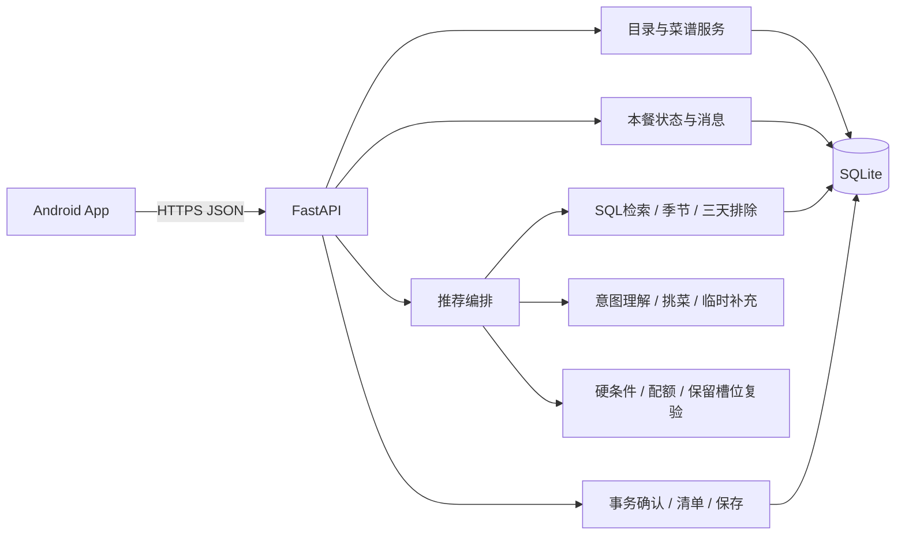

# 05 技术架构与 API

更新：2026-11-02；用户已批准进入 M1。本文是整体架构与目标 API，不代表 M2/M3 接口已实现；当前实现以 OpenAPI 和 M1 开发记录为准。Android 首版 APK 目标不变。

## 1. 技术栈

| 层 | 建议 | 原因与边界 |
|---|---|---|
| Android | React Native + Expo + TypeScript | 独立签名APK、移动组件；非网页/WebView；iOS不列首版 |
| 导航/UI | Expo Router Tab+Stack、局部状态、StyleSheet | 四入口与表单，处理返回键、安全区域和键盘；不引入复杂状态平台 |
| 设备存储 | AsyncStorage非敏感设置/ID/建议清单缓存；SecureStore接入凭证 | 不保存模型key，不复制可写业务数据库 |
| 服务端 | FastAPI + Pydantic | 校验请求/模型输出与OpenAPI；业务规则另做独立检查 |
| 数据 | SQLite + SQLAlchemy + Alembic | 单家庭、短事务、稳定迁移；不预建多实例架构 |
| LLM | 单提供商窄适配器 | parse、select/evaluate、generate三类任务；无自主工具代理 |
| 检索与记忆 | SQLite结构化查询 + 本餐状态JSON + 少量消息 | 不用embedding/向量库/专用RAG框架，不检索全部历史对话 |
| 测试 | pytest、移动组件测试、少量Maestro | 算法/事务/Android主流程，不以浏览器代替APK验收 |
| 构建 | development build调试，release签名APK交付 | 可本地Android工具链或可选云构建，不强制付费平台 |

Expo提供development build和独立应用构建，最终包不依赖Expo Go或Metro开发服务器。[Expo开发构建](https://docs.expo.dev/develop/development-builds/introduction/)、[Expo构建](https://docs.expo.dev/build/introduction/)

Pydantic的JSON Schema保障字段形状，不保障菜品满足业务条件，仍需规则复验。[FastAPI](https://fastapi.tiangolo.com/)、[Pydantic JSON Schema](https://docs.pydantic.dev/latest/concepts/json_schema/)

安装包不得含模型密钥；设备凭证可用SecureStore。[React Native安全说明](https://reactnative.dev/docs/security)、[SecureStore](https://docs.expo.dev/versions/latest/sdk/securestore/)

版本在开发时按兼容矩阵选稳定组合并锁定，最低Android版本结合家庭设备确认，不在设计阶段固定“最新版本”。

## 2. 模块与数据流



推荐代码目录（尚未创建）：mobile/app及src/{components,api,storage,types}；backend/app/{api,schemas,models,services,recommendation,llm,db}；tests；docs。一个API服务内分模块，无消息队列、微服务、Agent框架或检索平台。

本餐状态按context_id读取；历史按确认日期查询，不由模型挑选哪些历史算数。当前时间由后端提供。规则产生合格候选，模型挑桌，规则验桌；模型失败时满足条件才降级规则组合。

## 3. 执行、并发与恢复

推荐先保存generating会话，再释放数据库事务执行有预算的网络调用；建议总预算45秒。优先同步请求，不建立任务队列。返回201及业务状态；同key仍执行返回202与资源位置。状态变化不等于模型自由写库。

每个写入生成操作需Idempotency-Key；相同key相同输入返回原结果，不同输入409。App发送前保存key，后台或断网恢复使用原key取结果；不得新建请求重复付费。服务端应在接收后于预算内完成并落盘，若部署中断则明确failed/interrupted；联调验证ASGI断连行为。

同context并发调整带expected_session_id，合并条件和提交结果时做比较，过期409；不让慢响应覆盖最新桌。旧菜单快照不改，子结果记录parent_session_id。

确认在同一短写事务里重读日期、季节、最近三日确认集合，核对本餐最新结果，再写确认及关闭context；避免两个同时确认的桌重复。已有confirmation直接幂等返回。日期或数据变化时409要求审阅，不悄悄换菜后直接确认。重启清理遗留generating为中断失败。

## 4. 通用API约定

基础路径/api/v1，UTF-8 JSON，UTC时间ISO8601；本地确认日期由服务端Asia/Shanghai计算。ID不透明，示例不是种子数据。

创建201、执行中202、读改200、删204；422字段错、404不存在、409重名/状态/引用/过期/重复冲突，依赖级不可用503。推荐不足可创建资源但status=insufficient，不能伪装ready。列表limit默认30上限100、offset及total。

PATCH仅改提供字段；关联数组若传则整体替换。前端不能传source、安全结论、确认日期、排除历史或评分作为可信输入。普通错误体为error.code/message/details及request_id，不泄露堆栈和密钥。

## 5. 接口清单

| 方法/路径 | 用途 |
|---|---|
| GET /health；GET /dish-categories | 健康状态/菜品主分类 |
| GET/PUT /profile | 长期人数及分类配额 |
| GET /ingredients?q=&ingredient_category=&season= | 名称/别名检索；返回季节及当前派生状态 |
| POST /ingredients | 新建家庭食材；精确重名/别名409并建议复用 |
| PATCH/DELETE /ingredients/{id} | 自定义编辑/逻辑删；默认项仅可改季节与隐藏，引用冲突409 |
| GET /recipes?q=&category_id=&ingredient_id=&source= | 无图片菜谱检索 |
| GET/PATCH/DELETE /recipes/{id}；POST /recipes | 默认只读可隐藏，家庭菜谱三必填CRUD |
| POST /planning-contexts | 创建新一顿，继承家庭默认而非上顿临时限制 |
| GET /planning-contexts/{context_id} | 有效本餐状态、当前结果、最近消息和未决问题 |
| POST /recommendations | context内初次生成，或首次一并创建context |
| GET /recommendations/{id} | 结果/状态/清单/告警 |
| POST /planning-contexts/{context_id}/messages | 对话调整：理解目标并新建子结果；expected_session_id防过期 |
| POST /recommendations/{id}/resolve | 回答服务端clarification/check ID，不能任意传match |
| POST /recommendations/{id}/regenerate | 同context整桌重选，继承本餐条件及拒绝集合 |
| POST /recommendations/{id}/confirm | 最新ready结果确认，三自然日硬检查及幂等 |
| GET /recommendations/{id}/shopping-list | 预览或已确认快照 |
| POST /recommendations/{id}/dishes/{dish_id}/save | 用户主动保存临时菜，来源幂等 |
| GET/DELETE /preferences/{id} | 可选轻量长期偏好的读取/删除设计；列表用GET /preferences |

不再有market-ingredients接口或图片参数。消息接口覆盖“换这道”，无需再建一套重复换菜入口。通用锁定、历史浏览和高级反馈API留P1。明确永久偏好仅通过校验后的用户动作写入，模型无直接数据库工具。

## 6. JSON示例

### 配置、食材与最小菜谱

```json
{"people_count":4,"category_counts":{"meat":1,"vegetable":2,"soup":1}}
```

```json
{"name":"家庭自定义食材","ingredient_category":"vegetable","seasons":["summer","autumn"]}
```

seasons仅all_year表示全年；空/未提供表示未设置，不自动当全年。

```json
{
  "name":"虾滑金针菇豆腐鸡蛋汤",
  "category_id":"soup",
  "ingredients":[
    {"ingredient_id":"i_shrimp_paste","is_main":true},
    {"ingredient_id":"i_enoki","is_main":true},
    {"ingredient_id":"i_tofu","is_main":true},
    {"ingredient_id":"i_egg","is_main":true}
  ]
}
```

三必填以外全可空，实际校验ID，辅料已录也检查禁忌，不自动补步骤。

### 初次生成及对话

POST /recommendations，带Idempotency-Key：

```json
{
  "context_id":"ctx_demo",
  "overrides":{"people_count":2,"category_counts":{"vegetable":1,"soup":1}},
  "user_text":"想清淡一点"
}
```

结构化category_counts提供则整体替换；文本局部修改采用已校验patch。文本与表单冲突要澄清。用户meal_date不能改变服务端今天对应的排除范围。

POST /planning-contexts/ctx_demo/messages，新Idempotency-Key：

```json
{
  "expected_session_id":"rec_demo_01",
  "text":"这道汤换一个，其他不变",
  "target_dish_id":"dish_demo_soup"
}
```

target由点击菜卡时提供；纯文字可省略，由模型依据当前桌定位，不唯一则澄清。后端冻结非目标菜。答复包含新的session_id、parent_session_id、变更说明及完整菜单；失败也保留已接受本餐条件。

### 完整结果示例

示例日期与季节是固定测试数据；正式使用由服务端获取，食材季节示例不作为默认种子承诺。

```json
{
  "id":"rec_demo_01",
  "context_id":"ctx_demo",
  "status":"ready",
  "people_count":2,
  "category_counts":{"vegetable":1,"soup":1},
  "time_context":{
    "as_of_date":"2026-11-02",
    "timezone":"Asia/Shanghai",
    "current_season":"autumn",
    "repeat_window_start":"2026-10-31",
    "repeat_window_end_inclusive":"2026-11-02"
  },
  "dishes":[
    {
      "id":"dish_demo_veg",
      "slot_id":"vegetable_1",
      "recipe_id":"r_demo_veg",
      "name":"清炒西兰花",
      "category_id":"vegetable",
      "source":"family",
      "ingredients":[{"ingredient_id":"i_broccoli","name":"西兰花","is_main":true,"season_status":"in_season"}],
      "hard_constraint_status":"not_applicable",
      "reason":"未命中三日确认记录，主要食材季节符合；油盐用量需自行控制"
    },
    {
      "id":"dish_demo_soup",
      "slot_id":"soup_1",
      "recipe_id":null,
      "name":"豆腐汤",
      "category_id":"soup",
      "source":"ai_temporary",
      "ingredients":[{"ingredient_id":"i_tofu","name":"豆腐","is_main":true,"season_status":"in_season"}],
      "hard_constraint_status":"not_applicable",
      "reason":"汤类候选不足时补充，已校验分类、食材引用与三日排除"
    }
  ],
  "shopping_list":{
    "status":"preview",
    "items":[
      {"ingredient_id":"i_broccoli","name":"西兰花","season_status":"in_season","quantity":null,"unit":null,"dish_ids":["dish_demo_veg"]},
      {"ingredient_id":"i_tofu","name":"豆腐","season_status":"in_season","quantity":null,"unit":null,"dish_ids":["dish_demo_soup"]}
    ]
  },
  "warnings":[{"code":"QUANTITIES_UNSPECIFIED","message":"未录入完整用量，请按家庭份量采购"}],
  "pending_checks":[],
  "clarifications":[]
}
```

正好素1汤1，不是省略菜的伪完整结果。没有人工availability、图片或伪造数量；临时recipe_id为空，不入正式库。

### 待核对、不足和确认

硬禁辣但做法不明：status=awaiting_confirmation，pending_checks列check_id、dish_id、constraint_id及具体问题。resolve仅接受对应答案与必要说明，服务端核对证据后重验；明确已含禁用食材不能点“忽略”。

insufficient列所缺类型、required、eligible及原因，如REPEAT_WINDOW_EXHAUSTED、SEASONAL_CANDIDATES_INSUFFICIENT、EVALUATION_INCOMPLETE。三天不足不自动放宽。

确认成功：

```json
{
  "id":"rec_demo_01",
  "status":"confirmed",
  "confirmation_id":"conf_demo",
  "confirmed_local_date":"2026-11-02"
}
```

确认日期只由服务端产生。新确认与本桌冲突返回409 RECENT_DISH_CONFLICT；跨日/相关数据变化409 RESULT_CHANGED，重新审阅；重复本会话confirm返回原记录。

临时保存可提交空对象采用最小快照，返回family recipe_id并写saved_recipe_id。新食材需用户明确确认，不接受模型自行建目录。原快照来源仍为ai_temporary。

## 7. Android访问、安装和维护

- App通过完整HTTPS API Base URL连接单家庭服务。手机localhost不是开发电脑；真机需可达地址/调试通道。菜市场移动网络实时推荐需远程可达后端。
- 家庭接入建议可撤销高熵凭证，经一次接入写SecureStore，Authorization Bearer访问；不打进公共APK，不做注册/角色/租户平台。部署方式待定。
- 模型密钥仅后端环境变量；日志仅请求ID、计数/耗时/错误码，不默认完整记录敏感对话。
- 每连接启用SQLite外键，短事务，必要时WAL/busy timeout；模型网络调用不持写锁。备份并恢复演练。
- 规则降级必须保留硬过滤与已知本餐条件；后端不可达只能看建议缓存的已确认清单，不允许离线编辑或新推荐。
- release签名APK内含运行JS/资源，关闭Metro仍可启动；联网业务依赖后端。交付包名、版本、安装/升级/API连接说明及构建记录。
- 同包名与签名密钥、递增版本号支持覆盖升级；签名密钥由用户保管备份，不入仓库。家庭内部APK分发，不强制商店、AAB、自动更新或OTA平台。
- 真机验收首次安装、冷启动、后台恢复、覆盖升级；若采纳清单缓存则测试断网读取。iOS和离线推荐不在首版。
