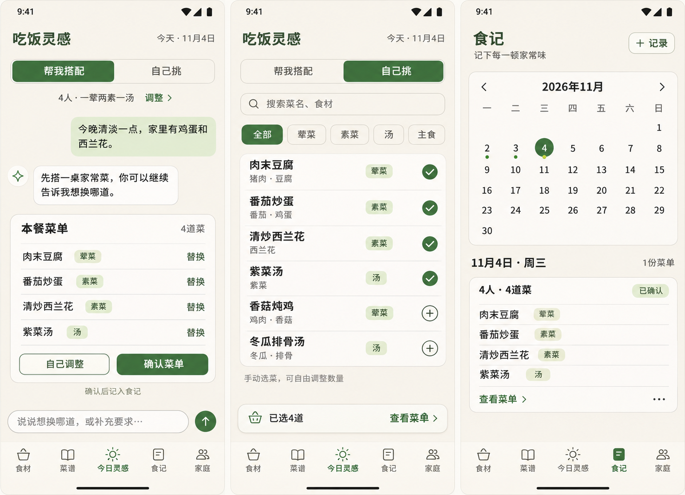

# 吃饭灵感：今日灵感与食记交互方案

更新：2026-11-05。视觉方案已获用户确认；A 自选与食记、B 规则搭配、C DeepSeek 对话均已实现，详见 [M2A 状态](M2A_自选与食记_开发状态.md)、[M2B 状态](M2B_规则搭配_开发状态.md)及 [M3 状态](M3_对话搭配_开发状态.md)。后文保留整体交互目标，实际实现边界以阶段记录为准。

本次会话确认优先于原 PRD 的旧描述：Android App；名称为「吃饭灵感」；无业务图片；食材及菜谱统一管理；食材使用季节、不维护市场状态；家庭默认仅计算荤菜、素菜、汤；自然语言调整与手动选菜共享同一份菜单。

## 1. 导航与视觉

五个一级入口依次为：食材、菜谱、今日灵感、食记、家庭。今日灵感居中，沿用现有暖白、深绿及紧凑文字卡片，不增加大幅装饰、菜谱照片或复杂动画。

「食记」是上一轮讨论提出并随整体方案接受的导航名称，可在视觉评审时调整。已生成的界面图是示例内容，不代表真实推荐、历史或现有数据库。

## 2. 今日灵感：两个入口，一份菜单

顶部使用分段切换「帮我搭配／自己挑」。切换只改变操作方式，保留本餐人数、要求、当前选菜和对话。明确点击「新建一餐」才开始新的草稿；有未确认菜时提示是否保留，避免无意清空。

### 帮我搭配

采用对话流：用户气泡、AI 简短说明、可操作的整桌菜单卡片。未输入特殊要求时可点击「按家庭习惯搭配」，读取家庭配置进行基础推荐。

默认给一套完整方案；只在歧义影响人数、硬限制或替换对象时追问，不要求用户每次从多套方案中选一套。规则和 LLM 的职责沿用已确认推荐设计，不把全部业务交给模型。

菜单卡片显示人数、总菜数、菜名及分类，每道菜提供「替换」，底部提供「自己调整」「确认菜单」。缺失食材和限制信息不确定时，在相关菜上显示提示，不能以生成成功代替约束校验。临时 AI 菜明确标注，只有主动保存才进入菜谱库。

2026-11-05 更新：当前菜单固定在聊天滚动区域上方，使用紧凑卡片，分类跟随菜名同行。支持展开/收起，键盘出现时收起成摘要；更多操作收纳「整桌换一套」。模型过滤后的候选2保存在本餐中，按钮换菜从候选2选择，不发起对话或调用模型。用户主动发送对话时才重新筛选，具体实现见 M3 阶段记录。

用户说「第一道和汤换掉，另外两道保留」时，仅修改指定位置；保留菜 ID 和临时约束，重新检查整桌数量及冲突。无法辨认对象时询问，不自行重选整桌。

历史对话中的旧菜单卡片标记「已更新」或「已确认」，不再提供旧版本确认按钮。当前有效菜单只有一份，服务端拒绝确认过期版本。

对话输入框位于底部导航上方；键盘出现时输入框可见，对话区滚动。发送中防重复，失败可重试；失败保留当前菜单和用户输入。模型服务未配置时明确提示，自选仍可使用，不能伪造 AI 回复。

### 自己挑

使用紧凑的电子点餐式列表：搜索、单行菜品分类、菜名及主要食材、加入按钮。无价格、商品规格、支付或同一道菜的份数加减。

加入后显示勾选状态，再点可移除；底部固定「已选 N 道／查看菜单」。数量按实际选择计算，家庭配额作为提示，不强制手动选菜必须凑成一荤两素一汤。配饭米饭不自动作为一道菜加入。

从某道菜的「替换」进入自选时，显示正在替换的菜；选中一项后只替换这一道。常规自选模式允许同时加入、移除多道菜。返回对话时同步本餐菜单，并使后续模型了解手动调整后的结果。

## 3. 确认与食记

点「确认菜单」后，弹出简短确认面板：日期默认今天、人数及菜数、最终菜品。确认成功后写入食记，显示「已记入 11 月 4 日」，可直接查看。网络失败不显示成功，重复点击不产生多份记录。

食记顶部为月历，可切换月份；有记录的日期显示圆点，选中日期深绿突出。点击日期后，在日历下方展开当天菜单卡片，不强制进入新页面或反复弹窗。

同一天允许多份菜单，分别展示，不将晚餐覆盖在午餐上。没有记录时显示「这一天还没有记录」及「记录一餐」。记录入口复用自选流程，并携带选中日期。

每份记录支持查看、更正和删除；删除前确认。更正采用明确保存操作，已经确认的记录不会因继续聊天或后来修改菜谱而悄悄变化。

记录保存日期、人数及菜品快照，另存菜谱 ID 用于关联。菜谱改名或删除不破坏旧记录展示。用户删除或更正记录后，推荐避重复随之更新。

## 4. 日期、季节与避重复

- 日期使用 Asia/Shanghai。季节由后端按当前月份计算：春 3—5、夏 6—8、秋 9—11、冬 12—2。
- 只有确认后的菜单作为避重复依据，草稿、旧推荐及未确认对话不纳入。
- 记录日期用于食记归属及三自然日窗口，确认时间独立保存。今天及前两天已确认的菜，必须在推荐候选阶段排除，不能被高评分重新选入。
- 后续已确认：手动选菜允许主动重复，AI 搭配仍严格排除近期菜；首版仅记录今天与过去，不支持未来计划。

## 5. 实施顺序与验收

### A：食记与自选闭环

先建立菜单草稿、快照和记录接口；实现五导航、品牌名、自选、确认日期和日历。验收：同日多份不覆盖，退出后记录保留，重复确认不重复落库，菜谱删改不损坏历史，保存失败不丢失选择。

### B：规则搭配

接入已确认的季节匹配、家庭构成、整桌多样性及三日硬排除，生成菜单、单菜替换和采购清单。验收：配额正确，候选不足说明原因，硬排除可验证，采购清单去重且不伪造用量。

### C：自然语言对话

接入真实 LLM，完成需求理解、候选挑选、缺菜补充、本餐记忆及定向换菜。验收：换两道保留两道，手动调整后对话承接最新菜单，硬限制不被重试解除，临时菜不自动入库，模型失败有可恢复状态。

UI 可以先搭建，但未接通对话能力的版本必须清楚说明实际能力，不能展示模拟回复作为已实现功能。模型供应商、模型名称、地址及密钥在接入阶段配置；密钥仅放后端，不进入 App 或设计图。

## 6. 视觉稿说明

本轮使用内置图像生成工具生成三页并排提案。提示要求：Android 手机全屏、中文、暖白深绿、无图片、五导航；分别展示自然语言气泡及可调整菜单卡、电子菜单式自选列表及已选条、2026 年 11 月日历及选中日期的已确认菜单。

落地时以真实数据和上述交互约束为准。示例菜单不作口味、营养或过敏原保证；图中的自由选择数量提示不代表已决定放开近期避重复限制。
